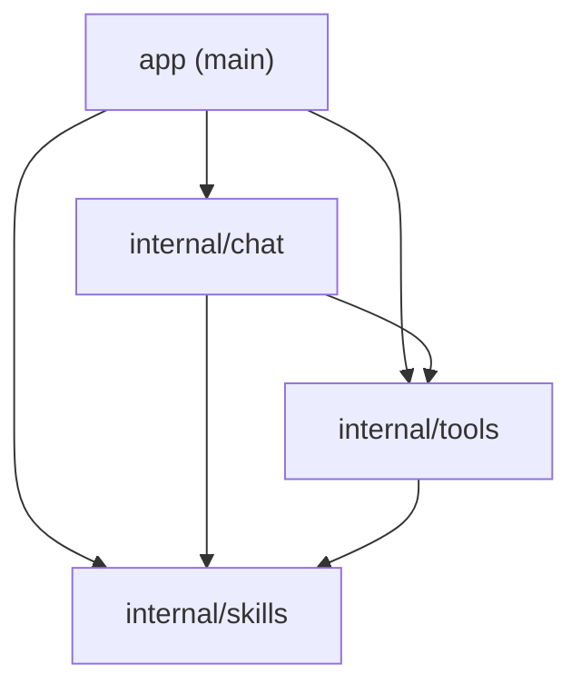
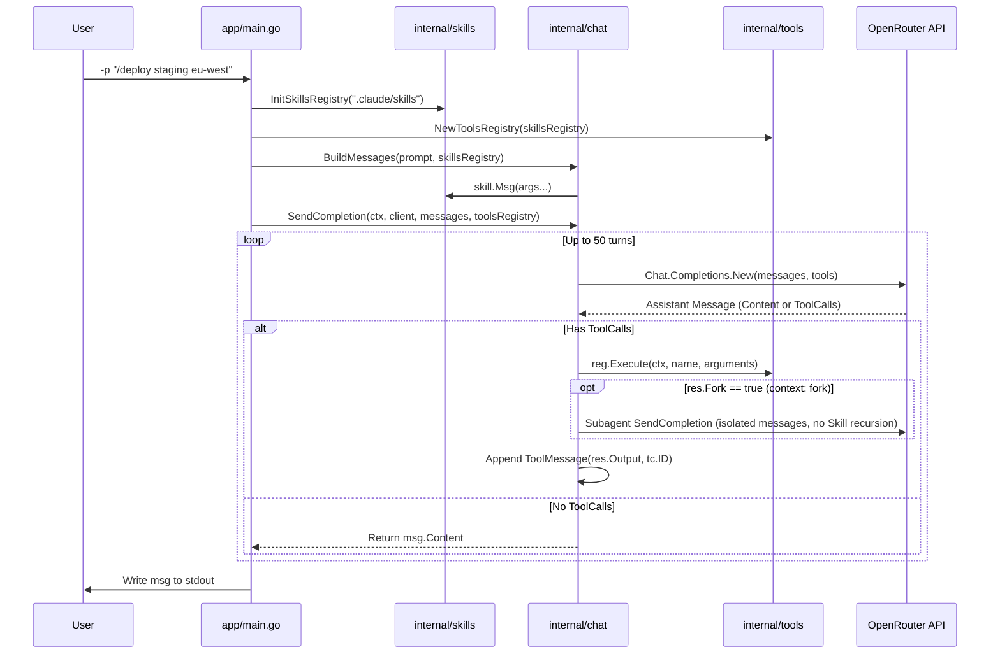

# Repository Structure & Architecture

Go implementation of the CodeCrafters **"Build your own Claude Code"** challenge. The CLI accepts a user prompt (`-p`), discovers local skills in `.claude/skills`, expands `/slash` commands, and runs an agentic tool-calling loop against an OpenAI-compatible Chat Completions API (`anthropic/claude-haiku-4.5` via OpenRouter).

---

## Directory Layout

```text
.
├── app/
│   ├── main.go               # CLI entrypoint, flag parsing, signal handling (SIGINT/SIGTERM)
│   └── main_test.go          # End-to-end integration tests with mocked HTTP transport
├── internal/
│   ├── chat/
│   │   ├── client.go         # OpenAI client setup, prompt/skill message builder, agentic loop
│   │   ├── export_test.go    # Test-only export wrapper for parsePrompt
│   │   └── client_test.go    # Black-box unit tests (package chat_test)
│   ├── skills/
│   │   ├── skills.go         # SKILL.md YAML frontmatter parser, registry, string substitutions
│   │   └── skills_test.go    # Black-box unit tests (package skills_test)
│   └── tools/
│       ├── tools.go          # Tool registry, JSON schema builder, Read/Write/Bash/Skill tools
│       ├── export_test.go    # Test-only export wrapper for runCommand
│       └── tools_test.go     # Black-box unit tests (package tools_test)
├── docs/
│   ├── README.md             # Repository structure and architecture overview
│   └── implementation.md     # Package-level implementation details
├── Makefile                  # Format, lint, race-enabled test, and 100% coverage targets
└── .golangci.yml             # Linter & formatter configuration (gofumpt, gci, golines)
```

---

## Package Dependency Graph

Dependencies flow strictly downward with zero circular references:



| Package | Responsibility | External Dependencies |
| :--- | :--- | :--- |
| `app` | CLI flags (`-p`), `signal.NotifyContext`, wires `skills`, `tools`, and `chat` | stdlib |
| `internal/chat` | Builds system/user messages, expands stacked `/slash` skills, runs the multi-turn completion loop and forked subagents | `github.com/openai/openai-go/v3` |
| `internal/tools` | Generic JSON argument unmarshaling (`withArgs[T]`), `Read`, `Write`, `Bash`, and `Skill` execution | `github.com/openai/openai-go/v3` |
| `internal/skills` | Loads `.claude/skills/*/SKILL.md`, parses YAML frontmatter, performs argument & variable substitution | `go.yaml.in/yaml/v3` |

---

## End-to-End Execution Flow



---

## Development Commands

All quality checks are driven through the [`Makefile`](../Makefile):

| Command | Action |
| :--- | :--- |
| `make` | Runs `fmt`, `lint`, `test`, and `coverage` in sequence |
| `make fmt` | Formats code via `golangci-lint fmt` (`gofumpt`, `gci`, `golines`) |
| `make lint` | Runs `golangci-lint run` (must report `0` issues) |
| `make test` | Runs `go test -v -race ./...` |
| `make coverage` | Generates `coverage.out` and prints per-function statement coverage (target: `100.0%`) |

